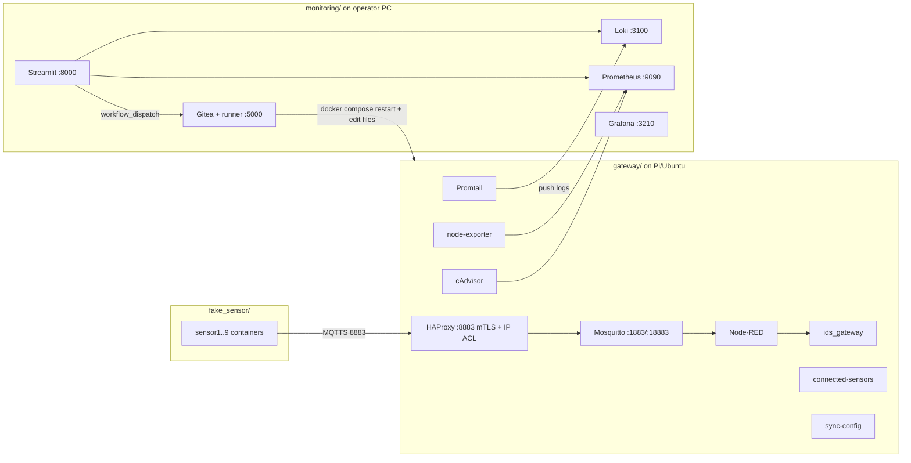
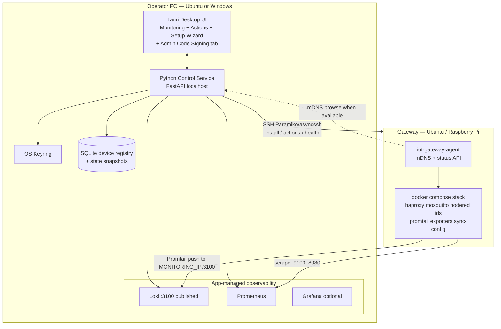
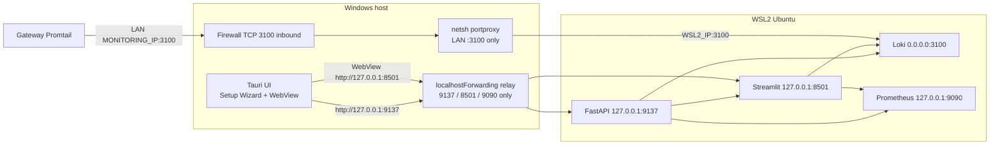

# Packaged Cross-Platform IoT Gateway Monitoring Application

| Field | Value |
|-------|-------|
| **Author** | IoT Gateway maintainers |
| **Date** | 2026-10-04 |
| **Status** | Draft (revised after design review) |
| **Workspace** | `/home/bach/workspace/iot-gateway` |
| **Related** | `README.md`, `gateway/docker-compose.yaml`, `monitoring/docker-compose.yaml`, `monitoring/build/streamlit/` |

---

## Overview

Today the IoT gateway project is three separately orchestrated Docker Compose stacks (`fake_sensor/`, `gateway/`, `monitoring/`) that require manual IP edits across `cert-generation.sh`, Promtail, Prometheus, Streamlit, Gitea seed, and sensor scripts, then a fixed start order (gateway → monitoring → fake_sensor). The monitoring UX is a Streamlit app that queries Loki/Prometheus and dispatches Gitea Actions workflows to mutate Mosquitto ACL/passwords and HAProxy `allowed-ips.txt` on a shared filesystem path (`/workspace/share/iot-gateway/...`).

This design packages the **monitoring machine** experience into a single cross-platform desktop application (Ubuntu + Windows) that: discovers the gateway on the LAN, installs and starts the gateway stack over SSH, auto-configures all IPs/endpoints, runs the observability backends without the user invoking `docker compose`, and exposes **Monitoring** and **Actions** tabs (device registration updates gateway whitelist/ACL **and** issues mTLS client certificates, plus a local device registry). The gateway device (Ubuntu / Raspberry Pi) continues to run its data-plane services as containers; the desktop app becomes the sole control plane and replaces Gitea Actions for day-2 operations.

“No docker compose” means **the user never runs compose by hand** — a container engine (Docker Engine on Linux, Docker Desktop or WSL2 Docker on Windows) remains a Setup Wizard prerequisite that the app detects and guides.

---

## Background & Motivation

### Current architecture (as implemented)



**Gateway stack** (`gateway/docker-compose.yaml`):

| Service | `network_mode` |
|---------|----------------|
| promtail, mosquitto, haproxy, nodered, node-exporter, cadvisor, connected-sensors | `host` |
| sync-config, ids | default (bridge) — volume-mounted logs/configs only |

**Monitoring stack** (`monitoring/docker-compose.yaml`): loki, grafana, prometheus (`network_mode: host`), streamlit, gitea, gitea-seed, gitearunner.

**mTLS path (important for registration):** Sensors connect to HAProxy `:8883` with `ssl … verify required` (`gateway/haproxy/haproxy.cfg`). Mosquitto `listener 1883` and `18883` bind to `127.0.0.1` only (`gateway/mosquitto/config/mosquitto.conf`); external clients cannot use password-only MQTT on the LAN without a CA-signed client certificate through HAProxy. Today’s `add_new_user.yaml` updates ACL / `mosquitto_passwd` / `allowed-ips.txt` but does **not** mint client certs — only `cert-generation.sh` / `update_key.yaml` cover fixed `sensor1`–`sensor4`.

**Control plane today**: Streamlit Control Plane tab (`monitoring/build/streamlit/modules/dashboards/control_plane.py`) calls `gitea_dispatch_workflow()` in `modules/utils.py`. Workflows under `monitoring/scripts/gitea_actions/.gitea/workflows/` mount gateway paths and mutate files. Paths are absolute (`/workspace/share/iot-gateway/...`), patched by `update_paths.sh`. Log-clear workflow is misnamed “Suricata” in UI/YAML but truncates `ids-alerts.log` for custom `ids_gateway`.

**Hard-coded endpoints (Phase-0 must clear all of these):**

| Location | Value |
|----------|-------|
| `monitoring/build/streamlit/app.py` | `LOKI_URL` / `PROMETHEUS_URL` / `GITEA_URL` → `172.17.0.1` |
| `monitoring/build/streamlit/modules/utils.py` | same + default `node_instance = "172.17.0.1:9100"` |
| `monitoring/config/grafana/provisioning/datasources/datasources.yaml` | Prometheus `http://172.17.0.1:9090` |
| `gateway/promtail/config/promtail-config.yaml` | Loki push `172.17.0.1:3100` |
| `monitoring/config/prometheus/prometheus.yml` | scrape `172.20.10.2:9100` and **`:8081`** (cAdvisor drift — upstream default is **8080**) |

### Pain points

| Pain | Evidence in repo |
|------|------------------|
| Manual IP configuration | `cert-generation.sh` `SERVER_CN`; sensor `HOST=`; Promtail/Prometheus/Streamlit/Gitea seed hard-codes |
| Multi-compose orchestration | README build/up order; `chmod 777 -R .` |
| Control-plane complexity | Full Gitea + seed + runner just to edit ACL/IP files |
| Incomplete “add user” for mTLS | `add_new_user.yaml` omits client certs required by HAProxy `verify required` |
| No discovery / remote install UX | Operator must pre-place gateway files and shared paths |
| Not a desktop product | Streamlit in Docker; Windows needs Docker Desktop + bash-like workflows |
| Credential defaults | Gitea `admin`/`admin`; CA password `admin` |

### Why change now

The functional core (mTLS MQTT via HAProxy, ACL, IDS, Promtail→Loki, textfile metrics, Streamlit dashboards) is valuable, but the **operator experience** blocks adoption. Packaging discovery, install, config templating, and actions into one app removes the bash/compose tax while preserving the gateway data plane.

---

## Goals & Non-Goals

### Goals

1. **Single desktop app** on Ubuntu and Windows for the monitoring/operator machine; user never runs `docker compose` or bash setup scripts by hand (container **engine** still required — see Setup Wizard).
2. **LAN gateway discovery** with confirm + SSH credential entry (Ubuntu user/password or key), with a documented matrix that works when mDNS is unavailable.
3. **Remote install & start** of the gateway stack on the discovered device; report health/status back to the app.
4. **Auto IP/endpoint wiring**: certificates SAN, Promtail Loki URL, Prometheus scrape targets, app datasource URLs — derived from discovered addresses, not hand-edited; **OS-aware** compose generation for Linux vs Windows.
5. **UI tabs**:
   - **Monitoring**: gateway activities, host metrics, sensor readings, alerts (parity with current Streamlit tabs Gateway / Raspi / Sensors).
   - **Actions**: register device (IP allow-list + MQTT user/ACL + **mTLS client cert** on gateway **and** local monitoring registry); ACL update; cert rotate; unregister; log clear; optional test-sensor launch.
6. **Clear split**: gateway keeps Docker for Mosquitto/HAProxy/**Node-RED (mandatory)**/IDS/exporters; monitoring UX is the packaged app; **Admin Code Signing** ships signed Windows/Ubuntu installers.
7. **Migration path** from the current three-folder compose layout.
8. **Secure credential handling** for SSH and device secrets (no secrets on remote argv; OS keyring; no production default `admin` CA passphrase).

### Non-Goals

- Rewriting the IDS model/rules (`gateway/ids/ids_gateway/`) or Node-RED decrypt flows in v1 (**Node-RED stays mandatory** — K17).
- Fully automated Windows Firewall / UAC rule injection in v1 (guided checklist only — K18).
- Supporting non-Ubuntu gateway OS (Windows IoT, bare OpenWRT) in v1.
- Multi-tenant SaaS / cloud-hosted control plane.
- Replacing Loki/Prometheus with a proprietary telemetry store in v1.
- Shipping fake_sensor as a required production component (dev/test / Lab only).
- Fully air-gapped installs without any prep — but field kits **may** use an optional image tarball (`provision --with-images`); that is supported, not a non-goal of documentation.

---

## Key Decisions

| # | Decision | Rationale |
|---|----------|-----------|
| K1 | **Desktop shell: Tauri 2 + local Python control service** | Small binaries vs Electron; Python reuses query helpers, Paramiko/asyncssh, cryptography/OpenSSL. Phase-0 embeds Streamlit for dashboard parity. |
| K2 | **Gateway remains Docker Compose on the device** | Host networking for broker/proxy/exporters, privileged cAdvisor, Mosquitto proxy protocol, HAProxy mTLS already proven. |
| K3 | **Monitoring backends auto-managed by the app (hidden Compose)** | Loki + Prometheus (+ optional Grafana **off by default**) started by the app. **v1 Windows path: control service + backends inside WSL2 Ubuntu** (Linux networking semantics); native Docker Desktop bridge compose is a documented alternative with explicit port publishes. “No compose” ≠ “no container engine.” |
| K4 | **Replace Gitea Actions with direct SSH actions** | Removes Gitea/runner/seed, `/workspace/share` coupling, and admin defaults from the critical path. |
| K5 | **Gateway agent (Python v1) for discovery + status** | Python for reuse with control-service libs; mDNS `_iot-gateway._tcp` + read-only `/v1/health`. SSH remains the mutation trust boundary. Agent is **installed at end of provision**; discovery never depends on agent for first install. |
| K6 | **Phase-0 UI = Streamlit embedded; Phase-1 = Tauri SPA** | Preserve ~2.3k LOC across `app.py` + dashboards + `utils.py`. Phase-0 **acceptance includes Register Device** via Streamlit→FastAPI (not deferred to a later “Actions polish” PR). |
| K7 | **OS keyring + SSH key preference; never put secrets on remote argv** | `keyring` backends; first connect installs app-generated ed25519 key and disables further password auth for that gateway in app settings. MQTT passwords: **hash locally** (ephemeral `mosquitto_passwd` / compatible PBKDF2) and SFTP only `user:$7$…` lines — never remote `mosquitto_passwd -b`. CA openssl: `-passin file:<0600-tmp>` then unlink (never `pass:` on argv). |
| K8 | **fake_sensor stays separate; optional “Lab” action** | Not part of production install. |
| K9 | **Config precedence: settings.json + `gateway.toml` render inputs → generated files; SQLite for registry/audit** | See Data Model. Render inputs always win over stale generated YAML. |
| K10 | **Register Device issues mTLS client certs via CSR/sign** | HAProxy `verify required` makes password-only registration insufficient for `:8883`. Operator generates key+CSR; gateway signs with CA; deliver `{ca.crt, client.crt, client.key}` via one-time localhost download; store metadata/expiry only. |
| K11 | **cAdvisor listens on 8080 explicitly; Prometheus scrapes three jobs** | Pin `--port=8080` in gateway compose templates; generate `node`, `cadvisor`, and textfile-relabel jobs. Fix today’s `prometheus.yml` `:8081` drift. |
| K12 | **v1 UX is single primary gateway; schema allows N≤5** | UI assumes one connected gateway; registry tables are multi-gateway-ready without multi-gateway UX in v1. |
| K13 | **CA private key remains on the gateway only** | Operator app holds CA **public** cert for distribution to devices; break-glass CA rotate is a separate action from server-cert rotate. **Client keys are generated on the operator** (control-service memory); only a CSR is sent to the gateway for signing — client private keys are never written on the gateway. |
| K14 | **Grafana optional, off by default** | Streamlit/Tauri Monitoring is sufficient for v1; “Open Grafana” when user enables the optional backend. |
| K15 | **cert-generation.sh + IP SAN is source of truth for TLS** | Do not copy `update_key.yaml` server step (missing SAN) or hard-coded sensor1–4 / host-absolute fake_sensor paths into production rotate. |
| K16 | **Admin Code-Signing surface ships distributable artifacts** | An **admin** role/area (same desktop app gated by local admin unlock, or a sibling Admin console) includes a **Code Signing** tab: load signing material via OS keyring / secure file prompt, sign Windows (Authenticode) and Ubuntu (debsig / GPG-signed AppImage or `.deb`) build outputs, and export shippable packages. v1 does **not** rely solely on opaque CI org secrets; CI may still *build* unsigned artifacts that an admin signs. |
| K17 | **Node-RED remains mandatory on the gateway in v1** | Preserve the existing decrypt → `sensor_data.log` path consumed by IDS and dashboards. Removing/replacing Node-RED is out of scope for this redesign. |
| K18 | **Windows Firewall: Setup Wizard guided checklist (not full automation)** | Wizard detects NAT/portproxy need, shows exact `netsh interface portproxy` and `netsh advfirewall` commands, and requires user confirmation after they run them (elevated). No silent UAC automation of firewall rules in v1; mirrored networking remains optional, not required. |

---

## Proposed Design

### High-level architecture



### Component breakdown

#### 1. Desktop application (`apps/desktop/`)

- **Tauri 2** frontend: Setup wizard, Monitoring tab, Actions tab, connection status, and (admin-gated) **Code Signing** tab.
- Embeds or launches **Python control service** (`apps/control-service/`) on `127.0.0.1:<ephemeral|9137>`.
- App data dir:
  - Linux: `~/.local/share/iot-gateway-monitor/`
  - Windows: `%APPDATA%\IoTGatewayMonitor\`
  - Contains: `settings.json`, `registry.sqlite`, generated compose overrides, CA **public** material, logs, SSH known_hosts-style fingerprints. Signing private keys are **not** stored in this tree — only keyring refs / last-used cert thumbprints.

#### 1b. Admin Code Signing tab (v1 scope — K16)

**Who:** Local **admin** unlock (OS user in an allow-list, or app password/PIN stored in OS keyring) reveals an Admin area. Non-admin operator installs never see the tab.

**Purpose:** Turn CI/local **unsigned** build artifacts into distributable, signed packages that field machines trust — without requiring every developer to hold org CI signing secrets.

**v1 inputs (secure prompt / keyring):**

| Platform | Signing material | Tooling (control service invokes) |
|----------|------------------|-----------------------------------|
| Windows | Authenticode cert + private key (`.pfx` via file picker → import to keyring/CSP, or existing cert store thumbprint) | `signtool sign` / `osslsigncode` on the built `.msi`/`.exe`/NSIS |
| Ubuntu | GPG private key for AppImage/`debsig` or packaged `.deb` | `gpg --detach-sign` / `dpkg-sig` / AppImage signing helper as chosen by packaging |

**v1 workflow:**

1. Admin selects artifact path(s) produced by the release build (or “Import build folder”).
2. Admin selects/loads signing identity (keyring ref or one-time secure file prompt; passphrase via OS prompt — never logged).
3. Control service runs the platform signer; writes signed outputs beside unsigned with clear names (`…-signed.msi`, `….AppImage` + `.sig`).
4. Optional: generate a small `SHA256SUMS` + signature; “Open export folder” for USB/ship.
5. `audit_log` records *who/when/what artifact/thumbprint* — never private key material.

**Out of v1:** Cloud HSM/KMS integration, automatic Store submission, notarization for macOS (not a target OS), multi-admin RBAC server. CI continues to produce **unsigned** binaries that admins sign in this tab (or a future thin Admin-only sibling app sharing the same control-service module).

#### 2. Python control service

| Module | Role | Builds on |
|--------|------|-----------|
| `discovery` | Manual IP + optional mDNS; optional agent-port probe | zeroconf when available |
| `provisioner` | Upload bundle; render templates; `compose up`; install agent last; optional `--with-images` | `gateway/` tree |
| `actions` | SSH mutations with secret-safe remote exec + compensating steps | Gitea workflow scripts |
| `certs` | CA/server/client with IP SAN; separate server vs CA rotate | `cert-generation.sh` |
| `telemetry` | OS-aware Loki/Prometheus lifecycle; scrape rewrite; readiness | `monitoring/config/**` |
| `registry` | Devices/gateways/audit + snapshot helpers | `modules/database/state.py` ideas |
| `status` | Agent poll + Prometheus `up` + Loki ready | new |
| `support` | `iotgw support-bundle` sanitized export | new |

#### 3. Gateway bundle (still containers)

Installed under e.g. `/opt/iot-gateway/` (configurable):

- Same services as `gateway/docker-compose.yaml`, with template fixes:
  - **cAdvisor** command includes `--port=8080` (explicit).
  - `promtail` client URL → `http://{{MONITORING_IP}}:3100/loki/api/v1/push`
  - `certs/` generated with `SERVER_CN={{GATEWAY_IP}}` and `subjectAltName=IP:{{GATEWAY_IP}}` (as in `cert-generation.sh`, not `update_key.yaml`).
- **New**: `gateway-agent` (compose or systemd), installed **at the end** of provision:
  - mDNS `_iot-gateway._tcp` TXT: `path=…`, `ver=…`, `mqtts=8883`, `agent=9138`
  - `GET /v1/health`, `GET /v1/info` — read-only; no mutation APIs in v1.

#### 4. Observability on the operator PC

##### Setup Wizard — container engine (explicit)

1. Detect Docker engine (`docker info`).
2. If missing: show OS-specific install guidance (Docker Engine on Ubuntu; **WSL2 + Docker** recommended on Windows; Docker Desktop as alternate).
3. **Block** “Start monitoring backends” until engine is healthy (not merely installed).
4. Clarify copy: *You will not run docker compose yourself; the app manages containers. A container engine is still required.*

##### Operator PC networking (Linux vs Windows)

**Supported v1 paths**

| OS | Supported path | Compose networking | `MONITORING_IP` | Firewall |
|----|----------------|--------------------|-----------------|----------|
| Ubuntu/Debian | Docker Engine on host | Prometheus may use `network_mode: host` **or** bridge with `9090:9090`; Loki **must** publish `3100:3100` on a LAN-reachable interface | Wizard lists IPv4 addresses on non-loopback interfaces (exclude `docker0`/`br-` by default); user confirms/overrides | Ensure inbound TCP **3100** from gateway subnet (Promtail push) |
| Windows | **Primary:** control service + Loki/Prometheus inside **WSL2 Ubuntu** (same Linux compose semantics); Tauri UI on Windows talks to `localhost` forwarded ports | Same as Linux inside WSL2 | See **WSL2 NAT normative sequence** below (default). Mirrored networking is an alternate when detected. | **Guided checklist** (K18): wizard shows exact portproxy + Firewall commands for TCP 3100; user runs elevated and confirms |
| Windows | **Alternate:** Docker Desktop with **bridge** compose (no host network) | Explicit `ports: ["3100:3100", "9090:9090"]`; Prometheus scrapes gateway via host LAN | Physical NIC IPv4 selected in wizard; never `172.17.0.1` | Inbound **3100** on that NIC |

##### WSL2 NAT — normative `MONITORING_IP` + portproxy sequence (v1 default)

Default WSL2 uses NAT: the distro’s eth0 IP (e.g. `172.x.x.x`) is **not** reachable from a LAN Raspberry Pi. Mirrored mode is optional and not assumed. Wizard algorithm:

1. **Detect path:** If `wsl --status` / networking mode reports mirrored (or `Get-NetIPInterface` shows LAN addresses inside WSL), set `windows_net_mode=mirrored` and use the WSL LAN IPv4 as `MONITORING_IP` (skip steps 3–4). Else `windows_net_mode=nat` (default).
2. **Pick `MONITORING_IP` (NAT):** Enumerate Windows host IPv4 on physical/Wi‑Fi adapters (exclude `127.0.0.0/8`, `172.16.0.0/12` WSL/Hyper-V vEthernet, `docker*`/`vEthernet (WSL)`). Present candidates; default = first RFC1918 address on the interface that shares a subnet with the gateway when known, else primary Wi‑Fi/Ethernet. User may override.
3. **Publish Loki in WSL2:** Compose must map `3100:3100` on `0.0.0.0` inside WSL2 (not only `127.0.0.1`).
4. **Host portproxy + firewall for Loki only (NAT only) — guided checklist (K18):** Wizard **detects** WSL2 IP and selected `MONITORING_IP`, then **displays** the exact commands for the user to run in an elevated PowerShell/CMD (copy button). User clicks “I have run these” → wizard re-probes. v1 does **not** silently elevate/automate firewall rules.
   ```bat
   netsh interface portproxy add v4tov4 listenaddress=0.0.0.0 listenport=3100 ^
     connectaddress=<WSL2_IP> connectport=3100
   netsh advfirewall firewall add rule name="IoT Gateway Loki 3100" ^
     dir=in action=allow protocol=TCP localport=3100
   ```
   Persist `WSL2_IP` in `settings.json`. On WSL restart, wizard/control service detects IP change and **re-shows** updated commands (optional “show refresh checklist”); does not auto-apply.

   **Do not** use `netsh portproxy` for FastAPI `:9137` or Streamlit `:8501`. Those bind to `127.0.0.1` inside WSL; traffic to `<WSL2_IP>:9137/8501` never hits a loopback-only listener. Tauri→API/Streamlit **requires** Windows localhost relay (`localhostForwarding=true` in `.wslconfig`, default on modern Win11). See Phase-0 topology readiness checks — if relay fails, block with a fix guide; do not “fall back” to portproxy.
5. **Write Promtail:** `clients[0].url = http://{{MONITORING_IP}}:3100/loki/api/v1/push` using the **Windows LAN** IP from step 2 (never the WSL NAT IP).
6. **Verify (mandatory acceptance for PR 6):** Over the existing SSH session to the gateway, run:
   `curl -fsS --max-time 5 http://{{MONITORING_IP}}:3100/ready` (or `/loki/api/v1/status/buildinfo`).
   Fail provision/connect with a user-visible error if this fails (“Pi cannot reach monitoring Loki — check firewall/portproxy”). Do **not** treat a Windows-local ping as sufficient.

**PR 6 acceptance:** Linux smoke + Windows WSL2 NAT path with **guided** portproxy/firewall checklist UX + SSH-from-gateway Loki ready probe green after user confirms steps.

**Generated Prometheus (all platforms)** — three jobs matching current intent of `monitoring/config/prometheus/prometheus.yml`:

```yaml
# Generated — do not edit by hand
scrape_configs:
  - job_name: node
    scrape_interval: 5s
    static_configs:
      - targets: ['{{GATEWAY_IP}}:9100']
        labels: { instance: 'gateway' }
  - job_name: cadvisor
    static_configs:
      - targets: ['{{GATEWAY_IP}}:8080']
        labels: { instance: 'gateway' }
  - job_name: node-exporter-textfile
    static_configs:
      - targets: ['{{GATEWAY_IP}}:9100']
    metric_relabel_configs:
      - source_labels: [__name__]
        regex: 'mqtt_connected_sensor.*'
        action: keep
```

**Provision-time probes (fail provision if unreachable after start window):**

- `GET http://{{GATEWAY_IP}}:9100/metrics`
- `GET http://{{GATEWAY_IP}}:8080/metrics`
- From gateway: `POST`/`GET` reachability check to `http://{{MONITORING_IP}}:3100/ready`

**Phase-0 Streamlit process model:** run Streamlit as a process managed by the control service (not inside the monitoring compose), with env:

```
LOKI_URL=http://127.0.0.1:3100
PROMETHEUS_URL=http://127.0.0.1:9090
NODE_INSTANCE=gateway   # or {{GATEWAY_IP}}:9100 — must match Prometheus labels / $node substitution
STREAMLIT_SERVER_ADDRESS=127.0.0.1
STREAMLIT_SERVER_PORT=8501
```

This avoids Streamlit-in-Docker needing `172.17.0.1` hacks on both Linux and Windows.

##### Windows Phase-0 runtime topology (Tauri ↔ WSL2)



| Component | Where it runs | Listen | How it is reached |
|-----------|---------------|--------|-------------------|
| Tauri shell + Setup Wizard chrome | Windows | n/a | — |
| FastAPI control service | WSL2 | **`127.0.0.1:9137`** | **Win11 `localhostForwarding` only** (Windows `127.0.0.1` → WSL loopback). Tauri uses `http://127.0.0.1:9137` + app token. **No portproxy** — eth0/`WSL2_IP` cannot reach a loopback bind. |
| Streamlit Phase-0 | WSL2 (child of control service) | **`127.0.0.1:8501`** | Same localhost relay; Tauri **WebView** → `http://127.0.0.1:8501`. **No portproxy.** |
| Prometheus | WSL2 compose | `127.0.0.1:9090` | Scrapes from WSL; optional UI via localhost relay. Not LAN-exposed. |
| Loki | WSL2 compose | **`0.0.0.0:3100`** | (1) WSL-local / relay for operator tools; (2) **NAT path:** Windows LAN `MONITORING_IP` + **portproxy** `0.0.0.0:3100→WSL2_IP:3100` for Promtail (only service that uses portproxy). |

**Readiness / fail-diagnosis (Setup Wizard blocks until green):**

1. `wsl -e true` succeeds; show “Install/repair WSL2” if not.
2. Control service health: Windows `curl http://127.0.0.1:9137/health` — on failure show “WSL localhost forwarding broken” with steps to set `localhostForwarding=true` in `%UserProfile%\.wslconfig`, `wsl --shutdown`, relaunch. **Do not** suggest portproxy for 9137.
3. Streamlit: `curl http://127.0.0.1:8501` — on failure “Monitoring UI failed to start” or same forwarding error if API is up but WebView cannot load; open WSL control-service log path.
4. Loki ready **from gateway SSH** (not only from Windows): as in NAT step 6 (validates portproxy path for `:3100` only).

**Explicit non-choice:** Phase-0 on Windows is **not** “CLI/Streamlit-only until Tauri.” Tauri ships in Phase-0 as the wizard + WebView host; all Python/backends stay in WSL2 per K3.

**Image cache / field kits:** minimum image set documented (mosquitto, haproxy build, nodered build, promtail, node-exporter, cadvisor, ids build, loki, prometheus). `iotgw provision --with-images ./images.tar` loads via `docker load` on the gateway before `compose up`. Cold pull 5–20 min remains the default online path.

#### 5. Ideal user flow (sequence)

```mermaid
sequenceDiagram
  actor User
  participant App as Desktop App
  participant CS as Control Service
  participant GW as Gateway Device

  User->>App: Launch
  App->>CS: Setup Wizard: detect Docker engine
  CS->>CS: start backends (Loki/Prom) if engine ready
  CS->>CS: discovery: mDNS if available else wait for manual IP
  User->>App: Confirm host + SSH creds (or pick mDNS result)
  App->>CS: store password once / install ed25519 key; pin host key
  CS->>GW: SSH: check Docker; upload bundle; render templates; compose up
  CS->>GW: install agent last; probe :9100 :8080; Promtail→MONITORING_IP
  GW-->>CS: health OK
  CS->>CS: write Prometheus targets; registry gateway record
  App->>User: Monitoring tab live
  User->>App: Actions → Register device
  CS->>GW: SSH playbook: ACL + hashed passwd line + allow-list + CSR sign; reload services
  CS->>CS: upsert device registry; cache cert bundle for one-time download
  App->>User: Download client cert bundle; device in Monitoring
```

### Monitoring tab

| Current Streamlit (~2.3k LOC app+dashboards+utils) | Packaged app |
|---------------------------------------------------|--------------|
| Gateway Activities (`dashboards/gateway.py`) | Monitoring → Activities |
| Gateway Metrics (`dashboards/raspi.py`) | Monitoring → Host |
| Sensors Reading (`dashboards/sensors.py`) | Monitoring → Sensors; **filter to `monitor_enabled=1` devices** when registry non-empty; “Show all Loki deviceIds” toggle for raw view |
| Grafana dashboards | Optional deep link if Grafana backend enabled |

Phase-0: env-driven URLs; replace constants in `app.py`, **`modules/utils.py`** (including `node_instance`), and Grafana datasource templates when Grafana is enabled. Phase-1: `/api/query/loki` and `/api/query/prometheus` wrappers.

### Actions tab

| UI action | Gateway effect | Local effect |
|-----------|----------------|--------------|
| **Register device** | Upsert MQTT user + topics in `acl`; **write pre-hashed** `user:$7$…` line into `passwords` (hash on operator — see below); add IP to `allowed-ips.txt` (dedupe); **CSR/sign client cert** (key on operator, sign on gateway); backup `.bak`; reload mosquitto + haproxy | Upsert `devices` row; hold cert bundle in memory/`0600` tmp for one-time download; store metadata/expiry only |
| Update ACL | Port of `update_acl.yaml` → Python | Update registry topics |
| Update allow-list IPs | Port of `update_device_ip.yaml` | Sync linked device IPs when user confirms |
| Unregister device | Remove ACL block; delete `user:…` line from `passwords` (file edit, not `mosquitto_passwd -D` with secrets); remove IP **only if** no other device shares it; no client key on gateway to delete | Soft-delete or remove registry row; wipe any cached bundle; revoke download token |
| Rotate **server** cert (same CA) | Re-issue server cert with IP SAN; restart haproxy/mosquitto | Update expiry metadata |
| Rotate **CA** (break-glass) | New CA + server + **re-issue all `devices` client certs** (+ Lab sensors if enabled); user must redistributed bundles | Mark all device certs rotated; force re-download |
| Clear logs | Truncate mosquitto, nodered, haproxy, gateway-state, **ids-alerts** (not “Suricata”) | — |
| Lab: start fake sensors | Template `HOST={{GATEWAY_IP}}`; short-lived local compose | — |

MQTT password alone is **insufficient** for the production mTLS path (`:8883`); the UI states this and always produces a client cert bundle on register.

### HAProxy / Mosquitto mutation semantics

Standardize (do **not** copy the buggy `add_new_user.yaml` branch `if [ $RESTART_NEEDED = true];` missing spaces, nor `down -v haproxy` which removes anonymous volumes unnecessarily):

1. Backup target files with `*.bak.<epoch>`.
2. Write ACL / passwords / `allowed-ips.txt` on the host bind mounts (password file = hashed lines only).
3. **Mosquitto:** `docker compose restart mosquitto` (picks up ACL/password file changes).
4. **HAProxy entrypoint defect (required fix in PR 1):** current `gateway/haproxy/build/entrypoint.sh` ends with  
   `exec haproxy -W -db -f … 2>&1 | tee -a …`  
   The pipe makes container PID 1 the shell/`tee` side, **not** the HAProxy master — so `docker kill -s HUP` / `kill -HUP 1` will not reload `allowed-ips.txt` from the `:ro` bind mount. **Change entrypoint** so HAProxy master is PID 1, e.g. log to stdout only:
   ```sh
   # gateway/haproxy/build/entrypoint.sh (target)
   … prepare log dir …
   exec haproxy -W -db -f /usr/local/etc/haproxy/haproxy.cfg
   ```
   (Docker/`json-file` driver captures stdout; drop `| tee` or use a non-PID1 sidecar if a second file copy is mandatory.)
5. **HAProxy reload:** after entrypoint fix, `docker kill -s HUP iot-haproxy` (signal HAProxy master). Integration test must prove allow-list re-read without full recreate. Fallback: `docker compose restart haproxy` (as in `update_device_ip.yaml`). **Never** `down -v`.
6. Integration test: add IP → probe that HAProxy accepts from that source; deny from non-listed IP.

### What stays containerized vs native

| Location | Containers | Native / app-managed |
|----------|------------|----------------------|
| Gateway device | mosquitto, haproxy, **nodered (mandatory K17)**, ids, promtail, node-exporter, cadvisor, sync-config, connected-sensors | `iot-gateway-agent`; Docker Engine |
| Operator PC | Loki, Prometheus, (optional Grafana) — started by app | Tauri UI, Python control service, SQLite, Phase-0 Streamlit process |
| Dev machine | fake_sensor compose (optional Lab) | — |

### Discovery details

**Supported matrix (no silent SSH spraying):**

| Mode | When | Behavior |
|------|------|----------|
| **1. Manual IP / hostname** | Always | User supplies host; only then may the app attempt SSH with **user-supplied** credentials |
| **2. mDNS browse** | Avahi (Linux) or Bonjour (Windows) present | Browse `_iot-gateway._tcp`; show list; user confirms before SSH |
| **3. Optional agent-port probe** | User opts in + supplies CIDR (default: local interface /24) | TCP connect to **agent port only** (default 9138), not SSH port spray; present responders as candidates |

Windows without Bonjour → modes 1 and 3 only; document Bonjour optional install. Link-local `.local` resolution differs (Avahi vs Bonjour); UI always displays resolved IPv4 for confirmation. **Removed:** unbounded “scan LAN for SSH” / ARP-based auth probing.

### Status reporting

- Agent `/v1/health` every 10s when known.
- Fallback: SSH `docker compose ps --format json`.
- Prometheus `up{job="node"}`.
- UI chip: `Disconnected | Installing | Degraded | Healthy`.

### Expected scale

| Metric | Target / assumption |
|--------|---------------------|
| Gateways shown in v1 UI | 1 primary (schema ≤5) |
| Sensors per gateway | 10–50 |
| Log retention | 7–14 days local Loki (configurable) |
| UI query latency | &lt; 2s p95 for 24h windows |
| Provision time | 5–20 min cold pull; minutes with `--with-images` |

---

## API / Interface Changes

### Control service HTTP API (localhost only)

```http
GET  /api/v1/discovery/gateways
POST /api/v1/gateways/connect
POST /api/v1/gateways/{id}/provision
GET  /api/v1/gateways/{id}/status

GET  /api/v1/devices
POST /api/v1/devices                      # register (idempotent upsert)
PATCH /api/v1/gateways/{gid}/devices/{id}
DELETE /api/v1/gateways/{gid}/devices/{id}   # unregister playbook
GET  /api/v1/gateways/{gid}/devices/{id}/cert-bundle  # one-time download

POST /api/v1/gateways/{id}/actions/rotate-server-cert
POST /api/v1/gateways/{id}/actions/rotate-ca
POST /api/v1/gateways/{id}/actions/clear-logs
POST /api/v1/lab/fake-sensors/start

GET  /api/v1/query/loki
GET  /api/v1/query/prometheus
POST /api/v1/support-bundle
```

Bind `127.0.0.1` only; per-install random token between Tauri and Python.

### Device register — request/response schema

```json
// POST /api/v1/devices
{
  "gateway_id": "uuid",
  "user_id": "sensor5",          // ^[a-zA-Z][a-zA-Z0-9_-]{1,31}$
  "password": "...",             // min 8; never echoed back; not stored by default
  "ip": "192.168.1.50",          // IPv4 or CIDR
  "topic_read": ["alerts/+"],
  "topic_readwrite": ["sensors/sensor5/#"],
  "monitor_enabled": true
}

// 200 response
{
  "device": { "id": "sensor5", "gateway_id": "...", "ip": "...", "cert_expires_at": 1739..., "monitor_enabled": true },
  "cert_bundle_token": "one-time-download-token",
  "idempotent": false            // true if upsert matched existing id and applied diffs
}
```

**Idempotency:** same `user_id` on same gateway → upsert ACL topics (replace set), refresh password only if `password` provided, ensure IP present, re-issue client cert only if `reissue_cert: true` or cert missing/expired.

**Validation:** reject invalid IP/CIDR; topic strings must be legal MQTT filters; `user_id` reserved list includes `nodered`, `anonymous`.

**Unregister `DELETE /api/v1/gateways/{gid}/devices/{id}`:** compensating-aware playbook (see Operability). Composite identity matches schema `PRIMARY KEY (gateway_id, id)`.

### Password hashing (argv-free — normative)

Upstream `mosquitto_passwd -b` always puts the password on argv; interactive mode is unsuitable over non-TTY SSH. **Do not** use remote `-b` or `$(cat)` expansion.

**Normative method:**

1. On the operator (control service), run an ephemeral local helper — e.g. `docker run --rm -i eclipse-mosquitto:latest mosquitto_passwd -b -c /dev/stdout <user> <pass>` **only inside a local container whose argv is not on the gateway**, **or** implement Mosquitto’s PBKDF2/`$7$` hash in Python (`passlib` / vendored compatible hasher) so the plaintext never leaves the control-service process.
2. Produce a single line `user_id:$7$…` (or current Mosquitto format).
3. SFTP/merge into `{install_root}/mosquitto/config/passwords` (replace existing user line; keep file mode `0600`).
4. `docker compose restart mosquitto`.

Plaintext password is zeroized in control-service memory after hashing; never written to gateway disk except as hash.

### Client cert bundle — E2E CSR/sign flow (normative)

K13: CA private key stays on the gateway. Client private key stays on the operator.

```mermaid
sequenceDiagram
  participant CS as Control Service
  participant GW as Gateway OpenSSL CA

  CS->>CS: Generate client key + CSR in memory (CN=USER_ID)
  CS->>GW: SFTP CSR to /tmp/iotgw-csr-XXXX.csr (0600)
  CS->>GW: SSH: openssl x509 -req -CA ca.crt -CAkey ca.key -passin file:/tmp/ca.pass …
  Note over GW: ca.pass is 0600 tmp created for this command then unlinked; never -passin pass:
  GW-->>CS: SFTP back client.crt + ca.crt (public only)
  CS->>GW: unlink CSR + any tmp pass file
  CS->>CS: Assemble zip/tar of ca.crt + client.crt + client.key in memory
  CS->>CS: Mint one-time cert_bundle_token; cache ≤5 min or until first GET
  Note over CS: GET /cert-bundle returns bytes once then wipes cache; audit_log stores fingerprint/expiry only
```

**Alternate (non-default):** generate key+cert entirely on gateway, SFTP fetch into operator `0600` memory cache, delete remote client.key after fetch. Prefer CSR flow so client keys never touch gateway disk.

**CA openssl passphrase:** always `-passin file:/path/to/0600-tmp` (content written via SFTP, used once, unlinked in `finally`). Production profile refuses passphrase equal to `admin`.

### Before / after: device registration

**Before:** Streamlit → Gitea `add_new_user.yaml` → edit ACL/passwords/allowed-ips → flaky haproxy `down -v` — **no client cert**.

**After:**

```python
def register_device(gateway_id, user_id, password, ip, topic_rw, topic_r):
    # 1) Hash on operator — plaintext never on gateway argv/disk
    hash_line = mosquitto_hash_local(user_id, password)  # ephemeral local mosquitto or PBKDF2
    zeroize(password)

    client_key, csr_pem = gen_client_key_and_csr(cn=user_id)  # memory only

    with ssh_session(gateway_id) as ssh:  # key from keyring; host key pinned
        ssh.backup(f"{root}/mosquitto/config/acl")
        ssh.backup(f"{root}/mosquitto/config/passwords")
        ssh.backup(f"{root}/haproxy/allowed-ips.txt")
        # ... write ACL ...
        merge_password_line(ssh, f"{root}/mosquitto/config/passwords", hash_line)
        allow = add_ip_dedup(ssh.read(f"{root}/haproxy/allowed-ips.txt"), ip)
        ssh.write(f"{root}/haproxy/allowed-ips.txt", allow)

        # 2) CSR/sign on gateway — CA key never leaves gateway; client key never written there
        client_crt, ca_crt = sign_csr_on_gateway(ssh, root, csr_pem)  # passin file: + unlink

        ssh.check_call(f"docker compose -f {root}/docker-compose.yaml restart mosquitto")
        reload_haproxy(ssh, root)  # HUP after entrypoint PID-1 fix; else restart

    token = cache_cert_bundle(ca_crt, client_crt, client_key)  # memory / 0600 tmp; one GET
    registry.upsert_device(gateway_id, user_id, ..., cert_expires_at=..., fingerprint=...)
    return token
```

### Template substitution

```
{{GATEWAY_IP}}       → confirmed address
{{MONITORING_IP}}    → wizard-selected LAN IP (OS-aware)
{{INSTALL_ROOT}}     → /opt/iot-gateway
{{SERVER_CN}}        → GATEWAY_IP
{{CADVISOR_PORT}}    → 8080
{{AGENT_PORT}}       → 9138
```

---

## Data Model Changes

### Config precedence (`settings.json` / render context)

```
settings.json
  monitoring_ip, nic_name, backends: {grafana: false}, windows_path: "wsl2"|"docker_desktop"
  known_hosts: [{host, fingerprint, added_at}]
  ssh_key_ref: keyring identifier

gateway.toml (per gateway, under app data or on device)
  gateway_ip, install_root, cadvisor_port=8080, agent_port=9138

Generated files (prometheus.yml, promtail-config.yaml, compose overrides)
  Always re-rendered from the above; never hand-edited as source of truth

registry.sqlite
  Authoritative for devices/audit/snapshots — not for endpoint IPs
```

### Local SQLite (`registry.sqlite`)

```sql
CREATE TABLE gateways (
  id TEXT PRIMARY KEY,
  host TEXT NOT NULL,
  ssh_user TEXT NOT NULL,
  install_root TEXT NOT NULL,
  agent_url TEXT,
  fingerprint TEXT NOT NULL,
  monitoring_ip TEXT,
  password_auth_enabled INTEGER DEFAULT 0,  -- 0 after key install
  created_at INTEGER,
  last_seen_at INTEGER,
  status TEXT
);

CREATE TABLE devices (
  gateway_id TEXT NOT NULL REFERENCES gateways(id),
  id TEXT NOT NULL,                 -- MQTT username / cert CN (unique per gateway)
  ip TEXT,                          -- may be NULL if brownfield ACL-only import
  topics_rw TEXT,                   -- JSON array
  topics_r TEXT,
  monitor_enabled INTEGER DEFAULT 1,
  cert_expires_at INTEGER,
  cert_fingerprint TEXT,
  created_at INTEGER,
  meta_json TEXT,
  PRIMARY KEY (gateway_id, id)      -- same sensor1 allowed on two gateways (K12)
);

-- Brownfield: IPs not joinable to users automatically
CREATE TABLE imported_allowlist_ips (
  gateway_id TEXT,
  ip TEXT,
  linked_device_id TEXT,            -- device id within gateway_id; NULL until user links
  PRIMARY KEY (gateway_id, ip)
);

CREATE TABLE state_snapshots (
  id INTEGER PRIMARY KEY AUTOINCREMENT,
  timestamp INTEGER NOT NULL,
  state_type TEXT NOT NULL,
  data_json TEXT NOT NULL
);

CREATE TABLE audit_log (
  id INTEGER PRIMARY KEY AUTOINCREMENT,
  ts INTEGER,
  action TEXT,
  gateway_id TEXT,
  detail_json TEXT                  -- no raw passwords/PEMs
);
```

**Brownfield import:** parse ACL → device rows with `ip=NULL`; parse `allowed-ips.txt` → `imported_allowlist_ips`; UI “Link IP to device” before Monitoring treats them as fully registered. Do not invent joins.

**Monitoring filter:** Sensors tab default `deviceId IN (SELECT id FROM devices WHERE monitor_enabled=1)` when any such rows exist.

### Gateway filesystem (unchanged formats)

- `haproxy/allowed-ips.txt`, `mosquitto/config/acl`, `mosquitto/config/passwords`, `certs/` — same formats; **how** they are edited changes (SSH vs Gitea).

### Migration strategy

| Phase | Action |
|-------|--------|
| M1 | Add `apps/`; gateway templates pin cAdvisor `:8080`; monitoring compose remains for power users |
| M2 | SSH action modules + brownfield adopt |
| M3 | Desktop app GA; README app-first |
| M4 | Deprecate Gitea from default path |
| M5 | fake_sensor = Lab only |

---

## Alternatives Considered

### A1. Electron + embed full monitoring compose UI as-is

- **Pros:** Fast wrap. **Cons:** Heavy; leaves Gitea unless removed. **Rejected** as primary shell (Tauri preferred).

### A2. Keep Gitea Actions; only add discovery/install GUI

- **Pros:** Minimal control-plane change. **Cons:** Path coupling, credentials, Windows story. **Rejected** as end state.

### A3. Fully native gateway (no Docker on Pi)

- **Pros:** Fewer device moving parts. **Cons:** Reimplement HAProxy/Mosquitto/Node-RED/cAdvisor. **Deferred.** (Partial systemd packaging of the *same* containers via Podman quadlets is a possible later optimization — not v1.)

### A4. PyInstaller + Streamlit-only (no Tauri)

- **Pros:** Max reuse. **Cons:** Weaker native UX long-term. **Accepted as Phase-0 vehicle** (see also A6).

### A5. Flutter desktop

- **Pros:** Polish. **Cons:** Poor fit with Python SSH/cert/telemetry. **Rejected** for v1.

### A6. Streamlit UI + SSH actions inside monitoring stack (no Tauri yet)

- **Pros:** Smallest increment off today’s Streamlit; replaces Gitea with Paramiko in-process or sidecar; matches Phase-0 acceptance for Register Device. **Cons:** Still a browser/Streamlit UX; Windows packaging and Setup Wizard are weaker than Tauri; Docker-in-Docker/ssh-from-container pitfalls if Streamlit stays containerized — hence Phase-0 runs Streamlit **native** beside app-managed Loki/Prom. **Accepted as explicit Phase-0 architecture**; Tauri remains Phase-1 product shape (K6).

---

## Security & Privacy Considerations

### Threat model (summary)

| Threat | Severity | Mitigation |
|--------|----------|------------|
| SSH password theft from disk | High | Keyring; one-time password → ed25519 install; `password_auth_enabled=0` thereafter |
| MQTT/CA secret exposure via `ps` on gateway | High | Hash MQTT passwords on operator; write hash lines only. CA: `-passin file:` + unlink — never `pass:` / `-b` on gateway argv |
| Malicious LAN spoofing gateway | High | SSH host-key pin on first connect; refuse mismatch; mDNS is hint only |
| Localhost API abuse | Medium | `127.0.0.1`; per-install token |
| Client cert / CA key exfiltration | High | CA **private** key stays on gateway (K13); cert download is one-time token; audit_log redacts PEMs |
| Default `admin` passphrases | High | Production profile **refuses** CA passphrase `admin`; generate random where local auth exists |
| Product code-signing key theft | High | Admin-only tab (K16); material in OS keyring/CSP; never written to app data dir or audit_log; secure prompts for passphrases |
| Agent recon | Low | Read-only API |

### AuthN/Z

- Operator ↔ App: local OS user.
- App ↔ Gateway: SSH (key preferred).
- Sensors ↔ Gateway: mTLS (HAProxy verify required) + Mosquitto password/ACL + IP allow-list.

### Data handling

- MQTT passwords: hashed on operator; only hash lines on gateway; default **do not** store plaintext locally; optional keyring-backed vault if user opts in.
- Client private keys: generated on operator; one-time download to user-chosen path; wiped from control-service cache after GET; not retained in SQLite.
- Failed SSH auth: rate-limit attempts; audit failures without recording password.

---

## Observability

### Of the IoT system

Unchanged telemetry path: Promtail → Loki; node-exporter / cAdvisor`:8080` / textfile → Prometheus; IDS → `ids-alerts.log` → Promtail.

### Of the desktop app / control plane

| Signal | Mechanism |
|--------|-----------|
| Control service logs | Rotating file under app data dir |
| Action success/failure | `audit_log` + UI toast |
| Backend health | compose ps + Loki/Prom readiness; banner if down |
| Provision progress | SSE/WebSocket events |
| Support | `POST /api/v1/support-bundle` / `iotgw support-bundle` — settings (redacted), audit_log, gateway status JSON, recent control logs, **no** keyring secrets or PEMs |
| Orphan backends | App uninstall / “Stop backends” stops app-managed compose project by label `io.iotgateway.managed=1` |

---

## Rollout Plan

### Feature flags / modes

- `advanced.compose_ui`, `lab.fake_sensors`, `ui.streamlit_embed`, `backends.grafana`, `windows.path=wsl2|docker_desktop`, `admin.code_signing`.

### Staged delivery

1. CLI dogfood on Linux (`iotgw provision`, `iotgw devices register` with certs).
2. **Phase-0 app:** Setup Wizard (engine detect), OS-aware backends, Streamlit embed, **Register Device via FastAPI** (acceptance gate).
3. **Phase-1:** Tauri Monitoring/Actions SPA.
4. Windows installer after Linux E2E green + Windows smoke (WSL2 path).

### Rollback & action failure modes

**File-level:** `*.bak.<epoch>` before each mutation; `iotgw rollback` restores last known-good bundle under `/opt/iot-gateway.bak-<ts>`.

**Register playbook transaction (compensating actions):**

| Step | On failure |
|------|------------|
| 1 Backup ACL, allow-list, passwd | Abort |
| 2 Write ACL | Restore ACL bak |
| 3 Merge hashed password line | Restore passwd bak; restore ACL |
| 4 Write allow-list | Restore allow-list; restore passwd+ACL |
| 5 CSR sign (tmp CSR + passin file on gateway) | Unlink CSR/pass tmp; no client.key on gateway to delete; restore allow-list+passwd+ACL |
| 6 Restart mosquitto | Alert operator; leave files consistent; do not touch haproxy yet |
| 7 Reload/restart haproxy | If fail after mosquitto OK: retry HUP/restart; status `Degraded` with message “ACL live, allow-list may be stale until haproxy reload”; do **not** silently roll back mosquitto (would strand password/ACL vs running process) without operator confirm |

**SSH policy:** connect timeout 15s; command timeout 120s (cert gen 300s); 2 retries on transport errors only; no retry on auth failure.

**Disk-full on provision:** preflight `df` on install root; abort with actionable error before unpack.

**Control service crash:** backends keep running (labeled compose); on restart, reconcile state from `settings.json` + docker labels.

### Risks

| Risk | Severity | Mitigation |
|------|----------|------------|
| Docker Desktop / WSL2 UX on Windows | High | Wizard blocking checks; primary WSL2 path (K3) |
| Image pulls on slow Pi | Medium | `--with-images` tarball; progress UI |
| HAProxy reload vs restart | Medium | Integration test; HUP then restart fallback |
| Streamlit→Tauri drift | Medium | Shared Python query layer + golden tests |
| mDNS blocked | Low | Manual IP always (mode 1) |

---

## Open Questions

**All previously listed product open questions are resolved.** None remain blocking for implementation planning.

| # | Topic | Resolution |
|---|--------|------------|
| 1 | **Code signing** | **Resolved (K16):** Admin area / Admin app includes a **Code Signing** tab — admin loads signing material via OS keyring/secure prompt, signs Windows & Ubuntu artifacts, ships packages. CI may build unsigned; admin signs for distribution. |
| 2 | **Node-RED** | **Resolved (K17):** Node-RED **remains mandatory** on the gateway in v1 to preserve decrypt/log path for IDS and dashboards. Not in scope to remove. |
| 3 | **Windows Firewall** | **Resolved (K18):** Setup Wizard **guided checklist** — detect + show exact `netsh` portproxy/firewall commands; user confirms. **No** full automation in v1; mirrored networking optional, not required. |

*(Earlier technical resolutions already in Key Decisions: cAdvisor `:8080` — K11; N=1 UX — K12; CA on gateway — K13; Grafana off by default — K14; agent=Python — K5; cert SAN — K15; Windows backends in WSL2 — K3.)*

---

## References

- `/home/bach/workspace/iot-gateway/README.md`
- `/home/bach/workspace/iot-gateway/gateway/docker-compose.yaml`
- `/home/bach/workspace/iot-gateway/gateway/haproxy/haproxy.cfg` — mTLS `verify required`
- `/home/bach/workspace/iot-gateway/gateway/mosquitto/config/mosquitto.conf` — localhost listeners
- `/home/bach/workspace/iot-gateway/monitoring/docker-compose.yaml`
- `/home/bach/workspace/iot-gateway/monitoring/build/streamlit/app.py`
- `/home/bach/workspace/iot-gateway/monitoring/build/streamlit/modules/utils.py` — includes `node_instance = "172.17.0.1:9100"`
- `/home/bach/workspace/iot-gateway/monitoring/build/streamlit/modules/dashboards/control_plane.py`
- `/home/bach/workspace/iot-gateway/monitoring/config/prometheus/prometheus.yml` — `:8081` drift vs cAdvisor default 8080
- `/home/bach/workspace/iot-gateway/monitoring/config/grafana/provisioning/datasources/datasources.yaml`
- `/home/bach/workspace/iot-gateway/monitoring/scripts/gitea_actions/.gitea/workflows/*.yaml`
- `/home/bach/workspace/iot-gateway/cert-generation.sh` — SAN source of truth
- `/home/bach/workspace/iot-gateway/gateway/promtail/config/promtail-config.yaml`
- `/home/bach/workspace/iot-gateway/gateway/ids/`
- `/home/bach/workspace/iot-gateway/update_paths.sh`

---

## PR Plan

Incremental PRs with rough sizing (**S** &lt; 1d, **M** ~2–3d, **L** ~1w). Independently reviewable where noted.

### PR 1 — Config templating + cAdvisor port pin + HAProxy PID-1 (**M**)
- **Title:** `feat(config): template endpoints; pin cAdvisor --port=8080; fix Prometheus scrapes; HAProxy entrypoint PID-1`
- **Files:** `deploy/templates/`; `gateway/haproxy/build/entrypoint.sh` (remove `| tee` so `haproxy` is PID 1); `tools/render_config.py`; provision probe helpers
- **Dependencies:** none
- **Description:** Eliminate hand-edited IPs, correct `:8081` drift, and make HUP reload possible before action playbooks rely on it.

### PR 2 — Python SSH action library with secret-safe exec (**L**)
- **Title:** `feat(control): SSH playbooks — register (ACL+IP+hashed passwd+CSR cert), ACL, IPs, unregister, clear logs`
- **Files:** `apps/control-service/actions/`; local mosquitto hash helper; CSR/sign + `-passin file:` helpers; HAProxy HUP/restart helper; unit tests with mocked SSH; allow-list integration test
- **Dependencies:** PR 1 (cert templates + entrypoint)
- **Description:** Port workflows without Gitea; mTLS via operator-side key + gateway CSR sign; **no** remote `mosquitto_passwd -b`; backups + compensating steps.

### PR 3 — Local device registry + audit + brownfield import (**M**)
- **Title:** `feat(registry): SQLite gateways/devices/allowlist-import/audit`
- **Files:** `apps/control-service/registry/`; schemas; link-IP UI data APIs
- **Dependencies:** none (parallel to PR 2)
- **Description:** Upsert/delete contracts; ACL users vs allow-list IPs imported separately.

### PR 4 — Gateway agent (**M**)
- **Title:** `feat(gateway): Python iot-gateway-agent (mDNS + /v1/health)`
- **Files:** `gateway/agent/`; compose/systemd unit
- **Dependencies:** none
- **Description:** Optional until provision installs it; read-only API.

### PR 5 — Provisioner (agent optional) (**L**)
- **Title:** `feat(control): SSH provisioner — bundle upload, compose up, probes, install agent last`
- **Files:** `apps/control-service/provisioner/`; `--with-images`; rollback dirs; preflight disk checks
- **Dependencies:** PR 1; **PR 4 soft/optional** (provision succeeds without mDNS; installs agent when PR 4 present)
- **Description:** First install uses manual IP; agent is last step, not a hard prerequisite.

### PR 6 — OS-aware monitoring backends + engine wizard hooks (**L**)
- **Title:** `feat(control): lifecycle-manage Loki/Prometheus with Linux vs Windows/WSL2 compose`
- **Files:** `apps/control-service/telemetry/`; generated compose variants; NIC selection; **guided firewall/portproxy checklist** (copyable `netsh` commands + user confirm — K18); readiness checks; image set manifest
- **Dependencies:** PR 1
- **Description:** Deliver OS-aware compose **before** Windows installer skeleton. **Acceptance:** Linux smoke + Windows WSL2 **NAT** path with **guided** portproxy/firewall checklist for 3100 + **SSH-from-gateway** `curl MONITORING_IP:3100/ready` after user confirms; mirrored mode optional skip. On WSL IP change, re-display checklist (no silent firewall automation).

### PR 7 — FastAPI + Streamlit de-hardcode + Phase-0 Register Device (**L**)
- **Title:** `feat(control): FastAPI; wire Streamlit Actions to SSH register; purge hard-coded endpoints`
- **Files:** `apps/control-service/api/`; `app.py`, **`modules/utils.py`**, Grafana datasource templates; Control Plane → FastAPI (legacy Gitea flag off by default)
- **Dependencies:** PR 2, PR 3, PR 6
- **Description:** **Phase-0 acceptance:** Register Device (whitelist + ACL + cert + registry) works through embedded Streamlit. Clear all `172.17.0.1` / bad `node_instance` defaults; drive `NODE_INSTANCE` from gateway registry.

### PR 8 — Phase-0 desktop shell (**L**)
- **Title:** `feat(desktop): Setup Wizard (Docker/WSL detect, NIC, SSH pin/key install, firewall checklist) + Tauri WebView→Streamlit`
- **Files:** `apps/desktop/`; keyring; Linux AppImage; Windows Tauri hosting WebView to `127.0.0.1:8501` / API `:9137` via **localhostForwarding** (not portproxy); wizard UI for **guided** Loki portproxy/firewall steps (K18)
- **Dependencies:** PR 5, PR 7
- **Description:** Ideal flow binary; Register Device already live from PR 7. Windows: require localhost relay for UI ports; Loki `:3100` via user-confirmed checklist from PR 6 (not auto-applied firewall rules).

### PR 9 — Actions UX polish in Tauri / desktop chrome (**M**)
- **Title:** `feat(desktop): native Actions chrome — cert download UX, unregister, rotate server vs CA`
- **Files:** desktop Actions views; cert-bundle download; rotate split UI
- **Dependencies:** PR 8
- **Description:** Product polish beyond Streamlit forms; **not** the first time Register Device works.

### PR 10 — Phase-1 Monitoring UI migration (**L**)
- **Title:** `feat(desktop): native Monitoring tabs; monitor_enabled filters`
- **Files:** Tauri charts; `/api/v1/query/*`; golden query tests vs `gateway.py` / `raspi.py` / `sensors.py`
- **Dependencies:** PR 8
- **Description:** Remove Streamlit from default path.

### PR 11 — Lab fake_sensor launcher (**S**)
- **Title:** `feat(lab): short-lived fake_sensor with templated HOST`
- **Files:** lab module; desktop Lab panel
- **Dependencies:** PR 8
- **Description:** Optional demos only.

### PR 12 — E2E tests + support bundle + docs / deprecate Gitea (**M**)
- **Title:** `test+docs: E2E Linux register/provision; support-bundle; app-first README; deprecate Gitea`
- **Files:** E2E harness; `support.py`; README; migration doc; compose Gitea optional
- **Dependencies:** PR 7+
- **Description:** Linux E2E mandatory in CI; Windows smoke manual/CI later. Document Node-RED as mandatory gateway component (K17). Artifact signing flow documented under Admin Code Signing (PR 14), not CI-only secrets.

### PR 13 — Cert rotation module (server vs CA) (**M**)
- **Title:** `feat(certs): rotate-server (SAN) vs rotate-CA reissue-all-devices; no update_key.yaml SAN-less path`
- **Files:** `apps/control-service/certs/`; tests against `cert-generation.sh` behavior
- **Dependencies:** PR 2, PR 3
- **Description:** Can land parallel to PR 7–8; must merge before marketing “rotate certs” as production-safe. (Gateway MQTT/TLS certs — distinct from **product binary** code signing in PR 14.)

### PR 14 — Admin Code Signing tab (**L**)
- **Title:** `feat(admin): Code Signing tab — sign Windows/Ubuntu release artifacts via keyring`
- **Files:** `apps/desktop/` Admin area + Code Signing UI; `apps/control-service/signing/` (`signtool`/`osslsigncode`, GPG/debsig helpers); audit_log entries; docs for unsigned CI → admin-signed ship
- **Dependencies:** PR 8 (desktop shell + keyring patterns); can parallelize module work after PR 7
- **Description:** Implement K16 v1 scope: admin unlock, load signing identity (secure prompt/keyring), sign `.msi`/`.exe`/AppImage/`.deb`, export folder + checksums. No HSM/Store submission in v1. Does not replace gateway device TLS (PR 13).

---

*End of design document.*
