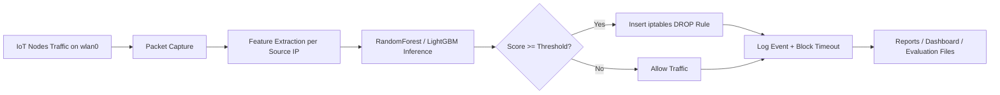

# IDS Edge AI Design for IoT Gateway

## 1. Technical Objectives

Design an IDS system on a Raspberry Pi gateway to:
- Monitor packet-header traffic from the IoT network (wlan0)
- Detect malicious behaviors such as Port Scanning and DDoS flooding
- Automatically block suspicious devices using iptables
- Operate reliably under edge resource constraints

## 2. Overall Architecture

Online processing flow:
1. Packet Capture: Capture packets on wlan0 in short time windows
2. Feature Extraction: Convert packets into feature vectors per source IP
3. Inference Engine: Run a trained RandomForest/LightGBM model
4. Decision Policy: Compare model score against a threshold
5. Enforcement: Insert DROP rules into the FORWARD chain
6. Monitoring: Log scores, block events, and false-positive statistics

Always separate:
- Offline training on a laptop
- Online inference on the Raspberry Pi

### 2.1 End-to-end Flow (Input -> Process -> Output)

```text
Input:
  IoT traffic packets from wlan0 (headers/flow behavior)

Process:
  (1) Packet capture window
  (2) Feature extraction per source IP
  (3) Model inference (attack probability)
  (4) Decision policy (threshold)
  (5) Mitigation (iptables block/unblock)
  (6) Logging and monitoring

Output:
  - attack score per source IP
  - binary decision (normal/attack)
  - enforcement action (block or allow)
  - evaluation and operation reports
```



## 3. Modular Breakdown for Review

### Module A - Data Plane Capture
File: ids_gateway/capture.py
- Responsibility: Capture packets from the AP interface
- Input: Raw packets
- Output: PacketRecord grouped by src_ip
- Review focus:
  - Maximum packet rate that the Pi can handle
  - Packet loss under burst traffic
  - Filtering only required packet types (IP/TCP/UDP/ICMP)

### Module B - Feature Engineering
File: ids_gateway/features.py
- Responsibility: Build features in a time window T
- Initial features:
  - pkt_count, tcp_count, udp_count, icmp_count
  - syn_count, ack_count, rst_count
  - unique_dst_port_count
  - avg_pkt_len, mean_inter_arrival_ms
- Review focus:
  - Whether features separate normal vs scan/flood traffic
  - Whether additional flow-level features are needed (bytes/s, packets/s)

### Module C - Model Training (Offline)
File: train/train_ids_model.py
- Responsibility: Train the model on processed datasets
- Supported models:
  - random_forest (preferred baseline)
  - lightgbm (for potentially higher accuracy)
- Evaluation:
  - Classification report (precision/recall/F1)
  - ROC-AUC
- Outputs:
  - models/ids_model.joblib
  - models/feature_scaler.joblib

Why these models are selected for edge IDS:
- RandomForest is robust on tabular network-flow features and easy to debug.
- LightGBM can improve accuracy on large datasets with low inference cost.
- Both are practical on Raspberry Pi because inference is lightweight compared with deep neural models.

Model objective:
- Binary classification for runtime decision: normal (0) vs attack (1).
- Optional scenario breakdown for DDoS-specific validation through attack_family reports.

Threshold policy:
- Model outputs attack probability from 0 to 1.
- Decision rule: if score >= suspicious_threshold -> block source IP.
- Threshold should be tuned from threshold_sweep.csv to balance recall vs false alarms.

### Module D - Inference Engine (Edge Runtime)
Files: ids_gateway/model.py, ids_gateway/detector.py, ids_gateway/main.py
- Responsibility: Load model and run real-time inference
- Logic:
  - Each cycle: sniff -> compute features -> predict_proba
  - If score >= threshold: mark as attack
- Review focus:
  - Inference latency
  - CPU/RAM usage on Raspberry Pi

### Module E - Response & Mitigation
File: ids_gateway/blocker.py
- Responsibility: Automatically block source IP using iptables
- Strategy:
  - Temporary block (default 600s)
  - Auto-unblock when timeout expires
- Review focus:
  - Avoid duplicate rule insertion
  - Add whitelist mechanism for trusted devices

### Module F - Configuration & Operations
File: configs/ids_config.yaml
- Responsibility: Manage runtime parameters
- Includes:
  - Interface, threshold, window, model path
  - Expected feature list
- Review focus:
  - Feature order consistency between training and inference

## 4. Model Training Data Flow

1. Collect PCAP from the gateway under scenarios:
   - Normal traffic (MQTT/CoAP/sensor upload)
   - Port scanning
   - SYN/UDP flooding
2. Convert PCAP -> flow/feature table
3. Label data:
   - label=0 normal
   - label=1 attack
4. Split train/test with an 80/20 ratio
5. Train + evaluate + save model

## 5. Quality Metrics

Recommended initial KPIs:
- Recall_attack >= 0.95
- Precision_attack >= 0.90
- ROC-AUC >= 0.97
- Mean inference time <= 50 ms/host/window
- False positive rate <= 3%

Why these metrics are used:
- Recall_attack protects availability: missing attacks (false negatives) is critical for gateway security.
- Precision_attack controls operational noise: low precision creates unnecessary blocks.
- ROC-AUC and PR-AUC measure ranking quality across thresholds.
- False positive rate is crucial for IoT systems to avoid blocking legitimate sensors.
- Inference time validates edge feasibility under limited CPU/RAM.

## 6. Module Test Plan

1. Unit tests for feature extractor with mocked packets
2. Integration tests for the sniff -> detect pipeline
3. Security tests with traffic generators (nmap, hping3)
4. Reboot tests to ensure IDS service auto-starts
5. Endurance tests for 6-12 hours to detect memory leaks

### 6.1 Detailed Testing Strategy (What + Why)

1. Data quality test before training
- What: verify label distribution, missing values, and class balance.
- Why: data imbalance and missing values can produce misleadingly high accuracy.

2. Offline model evaluation
- What: run train/evaluate and generate summary, confusion matrix metrics, threshold sweep.
- Why: threshold-independent and threshold-dependent quality must both be validated.

3. DDoS-specific scenario test
- What: check scenario_breakdown.csv and synthetic_scenarios.csv for DDoS detection behavior.
- Why: a general attack detector may still fail on DDoS families without focused validation.

4. Integration test in gateway loop
- What: run IDS loop and trigger normal traffic + attack traffic (nmap/hping3).
- Why: confirms end-to-end behavior from packet capture to mitigation action.

5. Stability/endurance test
- What: run for 6-12 hours and monitor CPU, RAM, and iptables rule lifecycle.
- Why: edge deployment reliability is as important as one-time accuracy.

## 7. How to Run the Current Skeleton

### 7.1 Install packages

```bash
pip install -r requirements.txt
```

### 7.2 Download BoT-IoT from Kaggle

```bash
python train/download_kaggle_dataset.py --dataset vigneshvenkateswaran/bot-iot --copy-csv-to data/raw
```

### 7.3 Convert BoT-IoT/TON_IoT to training schema

Quick test on large datasets (recommended first run):

```bash
python train/prepare_ids_dataset.py --input data/raw --output data/processed/ids_features.csv --max-files 3 --max-rows-per-file 200000 --sample-frac 0.3
```

If the dataset is heavily imbalanced, use class rebalancing:

```bash
python train/prepare_ids_dataset.py --input data/raw --output data/processed/ids_features.csv --max-files 10 --max-rows-per-file 200000 --sample-frac 0.5 --target-attack-ratio 0.6
```

Full preprocessing:

```bash
python train/prepare_ids_dataset.py --input data/raw --output data/processed/ids_features.csv
```

### 7.4 Train model offline

```bash
python train/train_ids_model.py
```

### 7.5 Run IDS loop on the gateway

```bash
python -m ids_gateway.main
```

### 7.6 Train core DDoS detector with CIC-DDoS2019

Use direct Kaggle download (Parquet format supported), then run:

```bash
python train/prepare_ids_dataset.py --download-cicddos2019 --kaggle-dataset dhoogla/cicddos2019 --download-to data/raw/cicddos2019 --input data/raw/cicddos2019 --output data/processed/ids_features.csv --ddos-only --max-files 20 --max-rows-per-file 250000 --sample-frac 0.5 --target-attack-ratio 0.6
python train/train_ids_model.py
python train/evaluate_ids_model.py
```

This mode keeps only normal + DDoS-like families and builds a binary DDoS detector.

Notes:
- The pipeline now supports both CSV and Parquet input files.
- CIC-DDoS2019 labels are parsed from attack-family columns (including Label) for DDoS filtering.
- If ddos-only mode returns a single-class dataset, increase max-files/max-rows-per-file or reduce sampling.

### 7.7 Detailed model testing (recommended before deployment)

Run detailed evaluation with threshold sweep and scenario reports:

```bash
python train/evaluate_ids_model.py
```

Generated reports:
- reports/evaluation_summary.json
- reports/threshold_sweep.csv
- reports/scenario_breakdown.csv
- reports/synthetic_scenarios.csv

Suggested acceptance checks:
- Recall_attack >= 0.95
- False positive rate <= 0.03
- DDoS detect_rate_as_attack should stay consistently high in scenario breakdown
- Synthetic DDoS scenarios should score above selected threshold

### 7.8 Deploy model to Raspberry Pi (production path)

Step 1 - Copy artifacts to Pi
- models/ids_model.joblib
- models/feature_scaler.joblib
- configs/ids_config.yaml
- ids_gateway package
- requirements.txt

Step 2 - Install runtime dependencies on Pi

```bash
pip install -r requirements.txt
```

Step 3 - Verify Pi runtime configuration
- Confirm capture interface in configs/ids_config.yaml (typically wlan0)
- Confirm model paths in config point to actual files
- Confirm hostapd/dnsmasq and forwarding/NAT are active

Step 4 - Run IDS service manually (first validation)

```bash
sudo python -m ids_gateway.main
```

Step 5 - Validate live behavior
- Generate benign traffic from IoT nodes
- Generate attack traffic (scan/flood) from controlled test node
- Confirm score logging, block action, and auto-unblock behavior

Step 6 - Persist as systemd service (recommended)
- Create a service unit to auto-start after reboot
- Restart and verify service, interface readiness, and iptables functionality

Deployment acceptance checklist:
- Service auto-start after reboot: pass
- Inference loop running without crash for >= 6h: pass
- DDoS test node is blocked within expected response time: pass
- Legitimate sensor traffic remains connected: pass

## 8. Next Steps for a Real Demo

1. Add IP/MAC whitelist for legitimate sensors
2. Add JSON logging + lightweight dashboard (Grafana/Prometheus or Streamlit)
3. Package the IDS as a systemd service on Raspberry Pi
4. Validate robustness with cross-dataset testing (CIC-DDoS2019 -> BoT-IoT/TON_IoT)
5. Run long-duration gateway test (6-12h) with live traffic and attack replay
